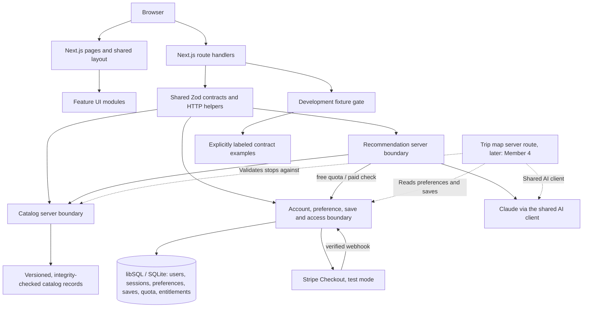

# Foundation Architecture

## Current implementation boundary

The foundation is one Next.js App Router application using React, TypeScript, plain CSS, and npm. Zod defines runtime data contracts; Vitest checks foundation behavior. Pages are present for every assigned feature, but external service integrations are intentionally unavailable.

Solid connections are implemented. Dotted connections are the AI trip map, which is not built yet. The database, Stripe and model connections are active only when their environment variables are set. The fixture gate requires `NODE_ENV=development` and `ENABLE_DEV_FIXTURES=true`; production always rejects that endpoint.

## Repository organization

| Path | Purpose |
|---|---|
| `src/app/` | Page entry points, shared layout, CSS, and API routes |
| `src/components/` | Shared interface components |
| `src/contracts/` | Shared schemas/types for catalog, accounts, preferences, saved items, recommendations, and access |
| `src/lib/server/` | Server-only HTTP/validation helpers |
| `src/modules/map-experience/ui/` | Exploration and item-detail UI |
| `src/modules/catalog/` | Catalog records (`data/`), integrity checks and filtering (`lib/`), and the catalog service (`server/`) |
| `src/modules/accounts/ui/` | Account, saved-item, and payment UI |
| `src/modules/accounts/server/` | Account, persistence, and payment/access boundary |
| `src/modules/recommendations/ui/` | Preference input and recommendation UI |
| `src/modules/recommendations/server/` | Recommendation boundary |
| `src/dev/` | Example data, never a production catalog or identity source |

## Decisions established by main

- **One application:** Shared pages and API routes use the same contract definitions, avoiding an independently deployed backend at the foundation stage.
- **Explicit module boundaries:** Each feature owner implements their assigned UI and/or server module. Shared routing, dependencies, and contract changes are coordinated by Member 3 after handoff.
- **Validated contracts:** Inputs and outputs have a common vocabulary before any feature branch starts. Runtime schemas complement TypeScript where data crosses HTTP or provider boundaries.
- **No credential dependency:** The baseline runs without any external setup. Unavailable adapters return structured errors rather than fake successful results.
- **Server-authoritative access:** An unconnected identity/access implementation cannot grant a paid capability. A future browser checkout redirect must never establish paid access on its own.
- **Distinct geographic relationships:** Bean origin, drink cultural association, and bean–drink pairing remain separate concepts. A suggested pairing is not evidence of a cultural tradition.
- **No client secrets:** Provider credentials and privileged integrations stay in server-only modules. Client components may use safe contracts and HTTP responses, never server modules.

## Decisions made by Member 3 (catalog, accounts, payments)

- **Catalog in Git, users in a database.** Curated content changes through reviewed pull requests and needs no import on deploy. User data lives in libSQL/SQLite (a local file, or Turso when hosted), and its schema is created on first use.
- **Own email + password authentication.** Passwords are hashed with scrypt, sessions are random cookie tokens stored as HMACs, and there is no third-party identity provider to configure.
- **Paid benefit:** 3 free AI recommendations, then a one-time Stripe test payment for unlimited ones. Only verified webhooks grant access, and duplicate events are idempotent.
- **Hosting target:** Vercel + Turso ([DEPLOYMENT.md](DEPLOYMENT.md)).

## Decisions for the feature owners

The final catalog coverage, data store, identity provider, model provider, hosting service, and actual paid benefit are not selected by the foundation. Member 3 coordinates these choices with the relevant feature owners. They do not block Member 1's runnable baseline.

Member 3 updates this diagram and records actual providers, deployed infrastructure, and integration decisions after the feature branches merge. The final report should describe the implemented system rather than presenting this foundation diagram as a completed product.
