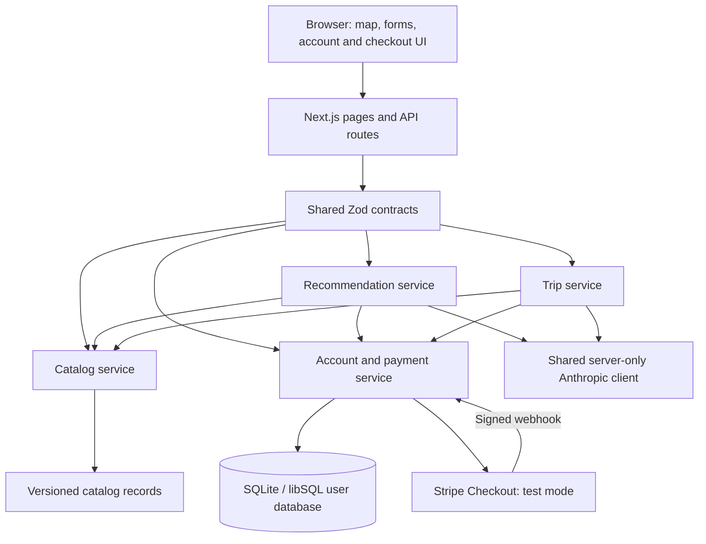

# Coffee Atlas: Personalized Coffee Discovery Through a World Map

**Capstone write-up · October 20, 2026**

**Implementation reviewed:** merged `main`, commit `1db47d0`

## 1. Problem and Product Objective

**Business question:** How can coffee-curious consumers discover beans and regional drinks that suit their tastes while understanding why they might enjoy them and where those choices come from?

Our target users enjoy coffee but lack specialist knowledge of origins, processing methods, tasting terminology, and regional preparations. They can describe familiar preferences—sweet, creamy, fruity, or black—without knowing which unfamiliar coffee to choose. Lists of origins and technical descriptions often leave the practical question unanswered: “What should I try next, and why?”

Coffee Atlas connects those preferences to a curated geographic catalog. Users explore a world map, read sourced descriptions, receive personalized recommendations, and turn their interests into a coffee-discovery itinerary. AI provides the product's core decision support: recommendations answer **what to try**, while the trip planner answers **where to explore it**. Explanations, trade-offs, and source links help users judge each suggestion.

This is a discovery and educational product. It does not sell coffee, identify operating cafés, book travel, or calculate realistic transport schedules. Its itinerary is an ordered set of catalog destinations, not a verified travel package.

## 2. Delivered Scope and User Journey

The merged application implements the following product requirements:

| Capability | Implemented behavior |
|---|---|
| Geographic discovery | Interactive globe, country and region views, and linked bean/drink detail pages. |
| Personal accounts | Email/password registration, login/logout, persistent preferences, and saved beans and drinks. |
| AI recommendations | Preference-based choices across the catalog or within a selected location, with reasons, trade-offs, and sources. |
| AI trip map | A requested 2–6-stop itinerary with numbered map pins, route lines, explanations, detail links, and saving. |
| Stripe test payments | Three free recommendations per account, followed by a one-time unlock for unlimited recommendations. |

A typical journey begins on the globe. A user selects a country or region, opens a bean or regional drink, and follows “Get recommendations like this.” The recommendation form accepts acidity, sweetness, roast, milk, flavors, preparation methods, and optional natural-language notes. The user signs in, saves preferences and interesting items, and receives suggestions with reasons and caveats. From “Plan a trip,” they request destinations based on their current preferences and optionally their saved collection.

After three successful free recommendations, the account needs the one-time Stripe test unlock. The same entitlement can also unlock trips when the server enables `TRIP_REQUIRES_ACCESS=true`. That switch is **off by default**, so trips are currently outside the payment gate unless deployment configuration enables it. Trip requests never spend recommendation credits.

## 3. Implemented Architecture

Coffee Atlas is one Next.js App Router application with React, TypeScript, and CSS. Page entry points and HTTP route handlers delegate to feature modules. Shared Zod schemas define request/response contracts and validate data at runtime. A central service registry connects the catalog, accounts, recommendations, and trip planner.

The reviewed dependencies include Next.js 16.4.2, React 19.3.1, MapLibre GL 5.24.0, Zod, libSQL, Stripe, and the official Anthropic SDK. Provider credentials stay in server-only modules. The application is hosted on Vercel; connecting a Turso user database remains pending. Local development uses a SQLite file, with tables created on first use.

### Catalog and geographic presentation

The actual catalog contains **60 countries, 54 regions, 61 beans, 27 drinks, 33 pairings, and 135 sources**. Records distinguish bean-growing origin from a drink's cultural association. Three pairings are labeled documented traditions; thirty are labeled suggested combinations. Unknown information stays empty rather than being inferred: sixteen beans currently have no sourced flavor notes.

Catalog content lives in Git because changes are curated and reviewed. On loading, schema and integrity checks reject duplicate IDs, broken references, invalid geographic relationships, and unknown source references. User records store catalog IDs instead of copying descriptions. This keeps map and AI content consistent and lets geographic browsing work independently of the account database.

MapLibre renders the globe using bundled country outlines. The trip page shares the exploration map's style and loaders but owns a separate map instance, avoiding interference with exploration navigation. Numbered pins and itinerary cards highlight each other. Great-circle lines connect stops; missing coordinates and WebGL failures preserve the usable stop list instead of inventing map locations.

### Accounts and payments

Passwords are hashed with scrypt. Sessions use random tokens in `HttpOnly`, `SameSite=Lax` cookies, with `Secure` enabled over HTTPS; the database stores session-token HMACs. Account writes reject cross-site origins, and user queries are scoped to the authenticated session. Ten failed sign-ins within fifteen minutes temporarily block that email's login. Preferences and saved items persist across sessions.

Stripe Checkout uses a server-configured one-time price and accepts test mode only. A checkout redirect does not grant access. The server verifies webhook signatures, test-mode status, checkout ownership, and event identity before granting the entitlement. Duplicate events are idempotent, and delayed, failed, expired, and out-of-order payment events are handled. The return page polls for the server's payment status.

Recommendation allowance is checked before a model request. Only a validated response containing matches consumes a credit. The final database claim is atomic, preventing simultaneous requests from delivering more than three free answers. Concurrent model calls can still happen before that final claim, which remains a cost-control limitation.

### AI pipeline and validation

Both features use `src/lib/server/ai-client.ts`, configured through `MODEL_API_KEY` and optional `MODEL_NAME`. The code's default model identifier is `claude-sonnet-5-5`. The shared client requests structured JSON, isolates provider errors, and applies SDK timeouts and retry behavior.

For recommendations, code first validates the selected location and starting item, then constructs eligible candidates. The model ranks and explains those candidates rather than supplying arbitrary catalog entries. Empty preferences and empty candidate sets return useful recovery suggestions without a model call. Validation checks candidate membership, uniqueness, nonempty reasons, and permitted source IDs before displaying matches.

For trips, the server reads account context itself; the browser cannot submit another user's saved list. Explicit form preferences take precedence over saved preferences. Code builds destinations containing relevant catalog items, and the model chooses and orders stops. Validation checks country/region membership, item availability at each stop, duplicate places/items, overlapping country-and-region stops, and reasons. Source IDs and saved-item indicators are supplied from trusted application data.

Both services retry an invalid answer once, then return an error. Missing configuration, provider outages, refusals, and insufficient preference information produce distinct responses. Notes are delimited as user data and the prompts direct the model to ignore instructions embedded in them. These controls validate structure and references; they do **not** prove every generated sentence or subjective preference match correct.

## 4. Engineering and Product Decisions

The principal design choice was to combine deterministic constraints with generative explanation. Code controls identity, entitlement, catalog eligibility, geography, and references. AI interprets everyday preferences and explains fit. This division narrows unsupported output while preserving personalization.

A shared contract layer and explicit feature modules supported parallel development across map, catalog/accounts/payments, recommendations, and trips. A shared AI client and save action reduce duplicated behavior. Keeping curated content in Git and personal state in a database separates editorial review from user activity.

The payment model demonstrates a meaningful product boundary: users experience the recommendation service before paying, and payment changes server-enforced access. A one-time unlock avoids subscription lifecycle complexity within the capstone scope. Configurable trip gating allows the same purchase to cover both AI features without a second product or entitlement.

## 5. Evaluation and Evidence

On October 20, 2026, the integrated `main` passed **`npm run verify`**: TypeScript checking, lint, **441 tests across 24 test files**, a production build, and a production smoke check covering **14 pages**. The smoke check also exercises API boundaries, production fixture isolation, fresh-database account persistence, trip context, and paid-trip gating.

Automated tests use controlled model responses to exercise invalid IDs, incorrect geography, duplicate results, missing reasons, retry behavior, and provider failures. Account/payment tests use real SQLite persistence and signed Stripe event payloads without a network payment. Integration tests connect the trip planner to real account state and a deterministic model, checking that the shared entitlement controls access.

Historical live-model evidence is separately recorded in [recommendation evidence](src/modules/recommendations/EVIDENCE.md) and the [trip module report](src/modules/trip-map/README.md), with screenshots. These October 19–20 runs used the earlier development preview catalog. They demonstrated normal recommendations/routes, contradictory preferences, and attempted instruction injection. The evidence also revealed variability: contradictory preferences sometimes produced clarification and sometimes qualified suggestions; a trip could backtrack geographically or place nearby pins on top of each other.

Those observations are useful qualitative evidence, but they are not a fresh live-model evaluation of the final integrated catalog. Likewise, signed local webhook tests are not proof of an actual Stripe-hosted checkout transaction. No recommendation-quality score, conversion claim, or production performance benchmark is asserted.

## 6. Deployment Status, Limitations, and Next Steps

Coffee Atlas is publicly accessible at **[coffee-atlas-phi.vercel.app](https://coffee-atlas-phi.vercel.app)**, deployed to Vercel project `harry-918a/coffee-atlas`. Unauthenticated HTTPS checks passed for fourteen pages, the catalog API, and map data. The live catalog matches the counts above, and the development fixture endpoint returns 404. This release publishes geographic browsing first; source was uploaded through the Vercel CLI without pushing Git or connecting GitHub deployment automation.

The live health endpoint reports the catalog as ready but accounts, payments, and AI as not configured. Account endpoints correctly return 503. Registration/login, live AI generation, and Stripe checkout are implemented and locally tested, but **are not enabled or accepted on the public deployment**. A public URL now exists; the assignment's complete end-to-end product requirement still needs those services.

Next, configure persistent database access, authentication, the model key, Stripe test price, and webhook endpoint. Then verify registration → saved preferences/items → live recommendation → actual Stripe test checkout → webhook unlock → continued recommendation and trip access on the public site.

Further work should evaluate recommendation relevance with users, standardize how contradictory preferences are handled, improve trip ordering and overlapping pins, and add sourced tasting information where it is missing. Larger catalogs will need candidate prefiltering to control prompt size, cost, and latency. Broader production use would also require stronger abuse controls, account recovery, operational monitoring, and refund/dispute handling. The current version establishes the complete local product flow while keeping these remaining delivery and product limitations explicit.
